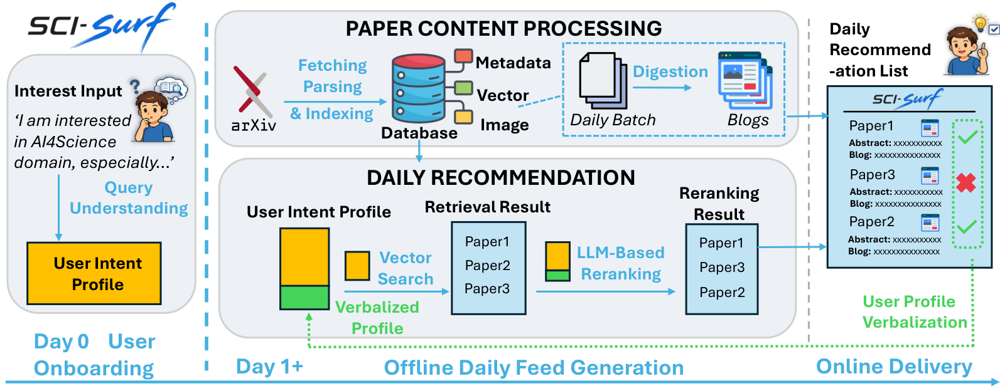

<picture>
  <source media="(prefers-color-scheme: dark)" srcset="frontend/public/brand/sci-surf-logo-dark.png">
  
</picture>

<h1 align="center">Sci-Surf</h1>

<h3 align="center">Discover papers that fit your research. Read the ideas that matter.</h3>

Intent-aware paper discovery · Feedback-driven recommendations · Blog-style digests

  <a href="http://8.130.190.218/"><strong>Explore Sci-Surf ↗</strong></a>
  &nbsp;·&nbsp; Demo video: coming soon
  &nbsp;·&nbsp; Paper: WWW '27 Demo Track submission

---

Sci-Surf helps researchers find relevant scientific papers and understand them efficiently. It turns research interests into a living intent profile, learns from feedback, and presents selected papers as approachable, multimodal digests.

## ✨ What Sci-Surf does

| Capability | How it helps |
| --- | --- |
| 🎯 **Personalized discovery** | Describe your research interests in your own words. Sci-Surf builds an intent profile, retrieves recent arXiv Computer Science papers, and reranks them using their full text. |
| 🔁 **Learning from feedback** | Feedback is verbalized into profile updates, so recommendations can follow your evolving research direction. |
| 📖 **Paper digestion** | Structured, blog-style digests bring together motivation, contributions, methods, results, and figures or tables. |
| ☀️ **Daily research feed** | An offline daily cycle prepares a personalized top-five reading list and its digests. |

## 🌊 From interest to insight

Start with a free-form description of what you care about. Sci-Surf uses it to find and rank papers, prepares a focused feed with digests, and incorporates your feedback into the next round of recommendations.

## 🧩 Codebase

| Directory | Role |
| --- | --- |
| [`frontend/`](frontend/) | Web interface |
| [`backend/`](backend/) | Application API |
| [`core/`](core/) | Paper processing, retrieval, reranking, and generation |
| [`orchestrator/`](orchestrator/) | Offline daily processing pipeline |

## 📍 Project lineage

Sci-Surf builds on the earlier [PaperIgnitionV1](https://github.com/Algnite-Solutions/PaperIgnitionV1) project as a research demonstration for the **WWW '27 Demonstration Track**.
